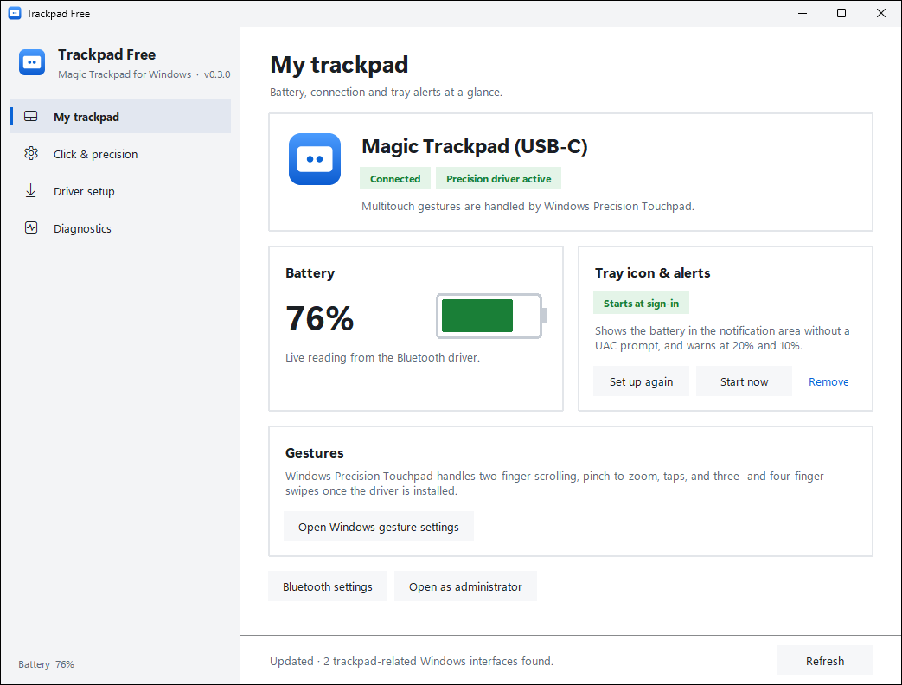
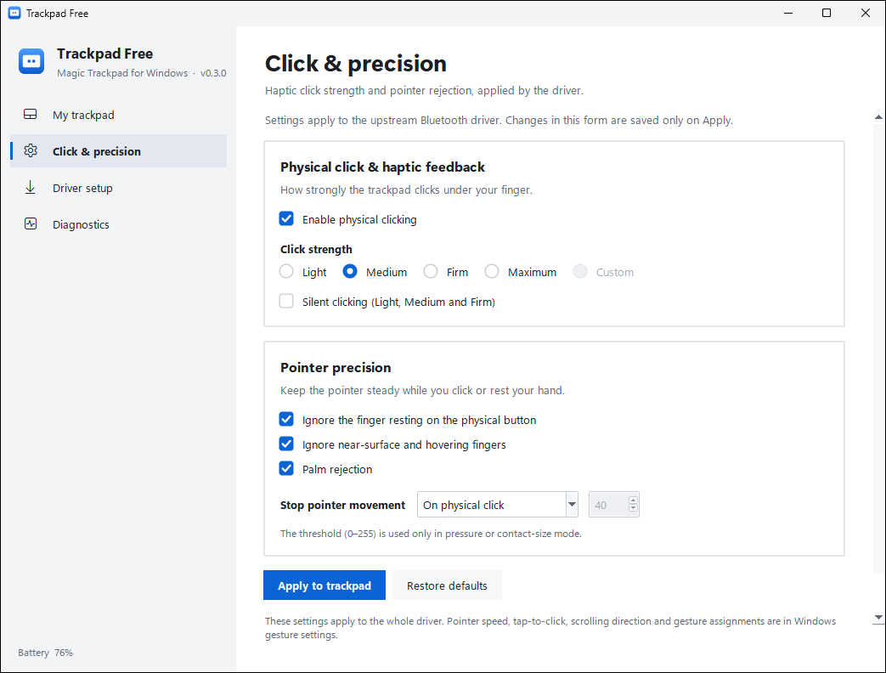
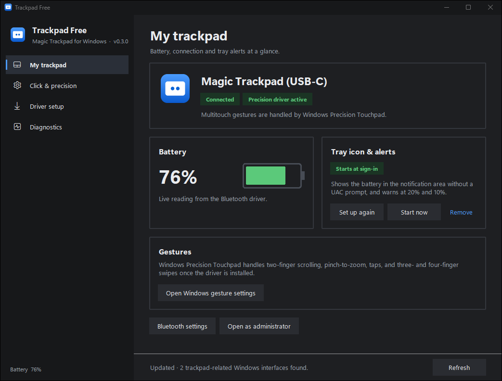
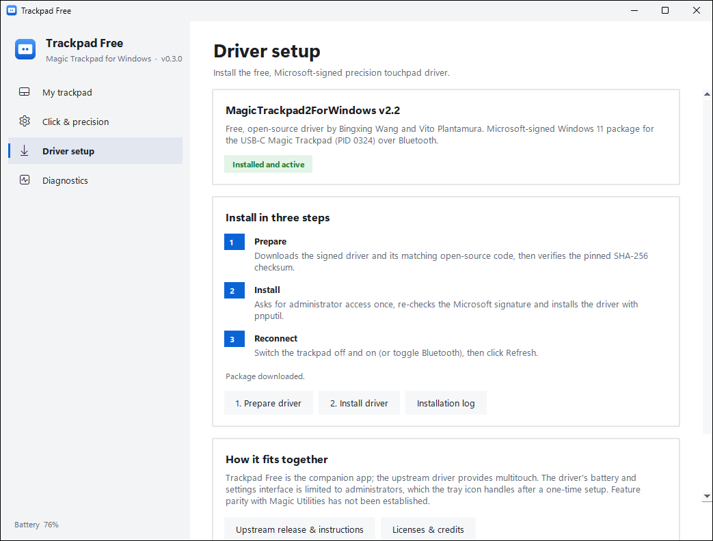
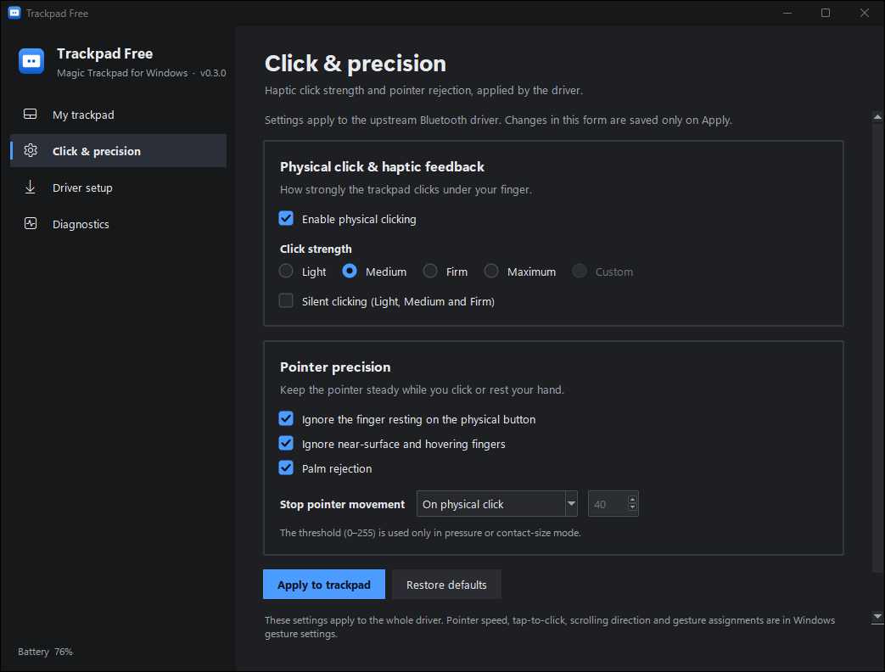

<p align="center">
  
</p>

<h1 align="center">Trackpad Free</h1>

<p align="center">
  A free, open-source Windows companion for the Apple Magic Trackpad:<br>
  precision-touchpad gestures, battery in the tray and click settings, with no subscription.
</p>

<p align="center">
  
  
  
  
</p>

<p align="center">
  
</p>

Trackpad Free starts with the **USB-C Magic Trackpad over Bluetooth**
(PID 0324) and aims for the features of paid utilities (gestures, battery
display, a settings app) without a subscription.

## Screenshots

| Light | Dark |
| --- | --- |
|  |  |
|  |  |

## Download

1. Install **Python 3.10 or newer** from
   [python.org](https://www.python.org/downloads/windows/) (keep *tcl/tk and
   IDLE* selected), or run `winget install Python.Python.3.12`.
2. Download `TrackpadFree-vX.Y.Z.zip` from the
   [latest release](../../releases/latest) and extract it to a folder only you
   can write to, for example `%LOCALAPPDATA%\TrackpadFree`.
3. Double-click `Start-TrackpadFree.cmd`, then follow the setup below.

## What works today

| Feature | Status |
| --- | --- |
| Detect the trackpad by hardware ID (not display name) | ✅ |
| Windows Precision Touchpad gestures (2-finger scroll, pinch, 3/4-finger) | ✅ via the precision driver |
| Battery percentage over Bluetooth | ✅ once driver installed (tray icon, or app as admin) |
| Tray icon with battery %, low-battery alerts at 20% and 10% | ✅ one-time admin setup, then no prompts |
| Click strength / silent clicking | ✅ once driver installed (admin) |
| Palm rejection, near-finger rejection options | ✅ once driver installed (admin) |
| Pointer-speed, tap-to-click, scroll direction, gesture assignment | ✅ handled by Windows Settings (link in the app) |
| USB-C wired connection | not yet tested |
| Exact Magic Utilities feature parity | not established — see THIRD_PARTY.md |

## How to set it up

1. **Start the app**: double-click `Start-TrackpadFree.cmd` (or `python app.py`).
2. Open the **Driver setup** tab → **1. Prepare driver**. This downloads the
   pinned, Microsoft-signed `MagicTrackpad2ForWindows` v2.2 package plus its
   GPL source and verifies the SHA-256 checksum.
3. Click **2. Install driver** and accept the UAC prompt. The installer
   re-verifies the Microsoft signature before running `pnputil`.
4. Reconnect the trackpad (toggle Bluetooth or the trackpad power switch),
   click **Refresh**.
5. On **My trackpad**, click **Set up tray icon** and accept the UAC prompt
   once. This registers a sign-in task (`\TrackpadFree\Trackpad Free Tray`)
   that starts `tray.py` with highest privileges, so the battery appears in
   the notification area at every sign-in without another prompt. Right-click
   the icon to refresh, open the app (already elevated) or exit.
6. For click settings without the tray, use **Open as administrator**.

The tray task runs `tray.py` from this folder with administrator rights, so
anyone who can edit this folder can run code as administrator. Keep it in a
folder only you can write to, and use **Remove** before moving or deleting it.

Requirements: Windows 11 (AMD64/ARM64), Python 3.10+, trackpad paired over
Bluetooth. Do **not** install Magic Utilities or Trackpad++ alongside this —
only one precision driver can claim the device.

## Files

- `app.py` — Tkinter companion app (overview, settings, driver setup, diagnostics)
- `ui.py` — Windows 11-style theme (light/dark, high-DPI), sidebar, cards, battery gauge
- `version.py` — the app version; release tags are `v<version>`
- `assets/` — app icon in every Windows size (generated by `tools/make_icons.py`)
- `devices.py` — name-independent Plug and Play discovery
- `driver_backend.py` — battery/settings client for the upstream driver
- `driver_package.py` — pinned download + SHA-256 + path-safe extraction
- `Install-Driver.ps1` — elevated installer with signature verification
- `tray.py` — dependency-free notification-area icon (battery %, low alerts)
- `Install-Tray.ps1` — registers or removes the elevated sign-in task for the tray
- `tests/` — hardware-free unit tests, run by GitHub Actions on Windows
- `tools/` — icon generator and README screenshot capture (demo data only)
- `THIRD_PARTY.md` — credits, licenses, and the exact driver interfaces used

## Uninstall

1. In the app, **My trackpad → Tray icon & alerts → Remove** deletes the
   sign-in task.
2. Remove the driver: Device Manager → Human Interface Devices → *Apple
   Multi-touch Trackpad HID Filter* → Uninstall device, with *Attempt to
   remove the driver for this device* ticked. Or, in an administrator
   terminal, find the `AmtPtpDevice.inf` entry with `pnputil /enum-drivers`
   and run `pnputil /delete-driver oemNN.inf /uninstall`.
3. Delete the Trackpad Free folder.

## Development

No third-party Python packages are needed. Run the tests with:

```
python -m unittest discover -s tests
```

The driver package (`drivers/`) is downloaded on demand and is not committed;
logs and local scratch files are ignored too. See
[CONTRIBUTING.md](CONTRIBUTING.md) for UI conventions, screenshots and
releases, and [SECURITY.md](SECURITY.md) to report a vulnerability.

## Troubleshooting

- **App says driver not loaded**: run the install step, then reconnect the
  trackpad. Check `driver-install.log`.
- **Battery shows “—”**: the upstream control device is restricted to
  administrators; set up the tray icon or restart Trackpad Free as administrator.
- **Tray icon missing**: click **Start tray now**, or check `tray-install.log`.
- **Conflicting gesture behavior**: uninstall Magic Utilities / Trackpad++ /
  the 2021 Apple Boot Camp driver first (Device Manager → Human Interface
  Devices → uninstall with driver software), then reinstall this driver.

This project is independent and does not use Magic Utilities code.

## License

Trackpad Free is licensed under the GNU General Public License v2.0 or later
(`GPL-2.0-or-later`), matching the upstream MagicTrackpad2ForWindows driver.
See [LICENSE](LICENSE) and [THIRD_PARTY.md](THIRD_PARTY.md).
